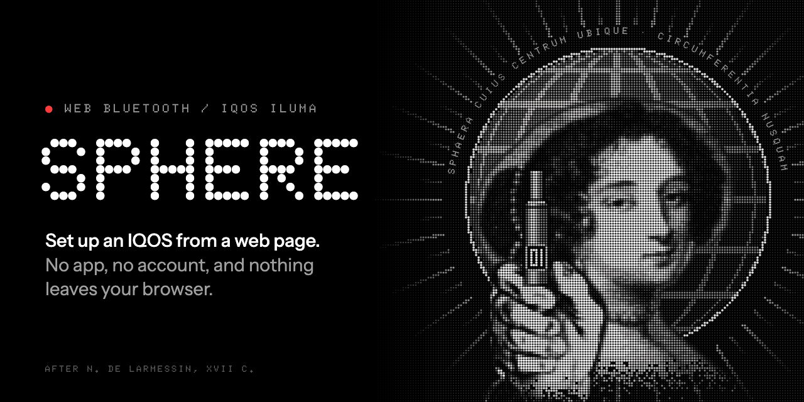

# About Me

  

🔭 I’m currently working on [@hauntedfail](https://github.com/haunted.fail/)

🌱 I’m currently learning: CoreBluetooth, RE

📫 How to reach me:
- www: [h1ka.ru](https://h1ka.ru)
- E-Mail: [me@h1ka.ru](mailto:me@h1ka.ru)
- Telegram: [@unittype](https://t.me/unittype)
- Matrix: [mlwr](https://matrix.to/#/@mlwr:matrix.org)
- NotABug: [nl](https://notabug.org/nl)
